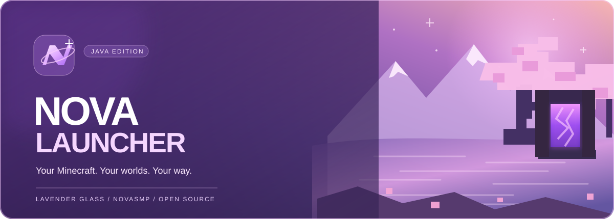

  

<!-- NOVA_DOWNLOAD_START -->

**[Windows Test 0.6 build](https://github.com/Thatboer/NovaLauncher/actions/runs/42855979348)** · [All downloads](https://github.com/Thatboer/NovaLauncher/releases)

The release publisher is being set up. The most recent Windows installer is currently under **Artifacts** on the successful build page.
<!-- NOVA_DOWNLOAD_END -->

 

**NOVA Launcher · Minecraft Java Edition** 🌸

*Cherry grove scenery. Lavender glass. A launcher built around you.*

> [!IMPORTANT]
> **Development preview:** Windows installer builds have succeeded, but Microsoft authentication, Minecraft launching and the final visual match to Design #5 still need real-world testing. Back up important game data before experimenting. This is an **unsigned test installer**.

## 💜 Latest Windows build

<!-- NOVA_STATUS_START -->
✅ **Windows Test 0.6 build completed** on November 10, 2026. [View build](https://github.com/Thatboer/NovaLauncher/actions/runs/42855979348). The automatic release publisher is being configured.
<!-- NOVA_STATUS_END -->

The **download button at the top automatically updates after each successful Windows build**. Every passing installer gets its own GitHub Release, and the homepage shows its build number, date and direct download. If a build fails, the homepage reports that failure while keeping the previous working download.

## ✨ Explore NOVA

<table>
<tr>
<td width="50%" valign="top">

### 🌸 Your own Minecraft home
A full-screen cherry-grove atmosphere, frosted lavender panels, NOVA branding and a bright purple Play button.

</td>
<td width="50%" valign="top">

### 🎮 Installations
Manage real Minecraft Java installations, filter by loader, inspect versions and launch your profiles.

</td>
</tr>
<tr>
<td valign="top">

### 👤 Minecraft accounts
Microsoft login and account management through a dedicated NOVA-styled Profiles screen.

</td>
<td valign="top">

### 🧩 Mods
Browse available Minecraft content and manage installed mods, including supported enable/disable controls.

</td>
</tr>
<tr>
<td valign="top">

### 🌐 Your servers
Save your own server addresses locally. **No server is forced into the list.**

</td>
<td valign="top">

### ⚙️ NOVA settings
Appearance, Minecraft memory, download options, accounts and advanced options in a lavender-glass interface.

</td>
</tr>
</table>

## 🖥️ Install on Windows

1. Click **Download for Windows** at the top of this page.
2. Once the latest GitHub Release appears, download the `NOVA-Launcher-Windows-Setup.exe` file directly. It does not require ZIP extraction.
3. Run the installer and verify the NOVA Home, Profiles, Mods and Settings pages.
4. This build is unsigned. Windows may show an unknown-publisher warning.

> [!NOTE]
> Don't replace a working launcher until the test build has been verified on your PC. The app's branding is NOVA. Open-source copyright and license notices still apply.

## 🎨 Design #5 progress

| Area | Current work |
| --- | --- |
| **Home** | Purple Play button, custom NOVA logo, glass cards and local background |
| **Installations** | Search, loader filters and playable instance rows |
| **Profiles** | Custom Microsoft account interface |
| **Mods** | Installed/Discover views and installed-content controls |
| **Servers** | Personal server favorites; no default SMP promotion |
| **Settings** | NOVA appearance and real launcher settings |

Still being polished: the exact cherry-grove **lake, mountain and portal** background from the concept images, per-page proportions, full Windows runtime testing, and remaining legacy UI inside advanced dialogs.

## 🛠️ Source, builds and licensing

**Current development:** [`modrinth-design5`](https://github.com/Thatboer/NovaLauncher/tree/modrinth-design5)  
**Previous builds:** [GitHub Actions](https://github.com/Thatboer/NovaLauncher/actions) · [All Releases](https://github.com/Thatboer/NovaLauncher/releases)  
**Design notes:** [NOVA Design #5](https://github.com/Thatboer/NovaLauncher/blob/modrinth-design5/docs/NOVA_DESIGN5_SPEC.md)

NOVA is a separate launcher identity developed using the open-source [Modrinth App code](https://github.com/modrinth/code) (GPL-3.0). Required source code, copyright notices and license obligations are preserved. NOVA is not affiliated with Mojang Studios, Microsoft or Modrinth.

**NOVA. Your Minecraft. Your adventure.** 💜

